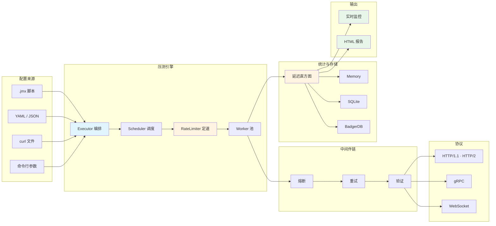

# go-stress

[](https://github.com/kamalyes/go-stress)
[](https://godoc.org/github.com/kamalyes/go-stress)
[](https://goreportcard.com/report/github.com/kamalyes/go-stress)
[](https://github.com/kamalyes/go-stress/blob/main/LICENSE)

⚡ HTTP / gRPC / WebSocket 压测工具 — 单条命令起步，支持定速压测、思考时间、数据驱动、JMeter 脚本导入与分布式执行

## 📦 安装

```bash
go install github.com/kamalyes/go-stress@latest
```

装完即可直接用命令名调用，二进制落在 `$(go env GOPATH)/bin`：

```bash
go-stress -url https://api.example.com -c 10 -n 100
```

> 若 `go-stress: command not found`，把 `$(go env GOPATH)/bin` 加入 `PATH`

<details>
<summary>其他安装方式</summary>

**从源码构建**

```bash
git clone https://github.com/kamalyes/go-stress.git
cd go-stress
go build -o go-stress .
```

**预编译二进制**

打 `v*.*.*` 标签会触发 CI 交叉编译并发布到 Releases，产物命名为 `go-stress-<系统>-<架构>`，覆盖 linux / darwin / windows / freebsd / openbsd / netbsd 与 amd64 / arm64 / 386 / ppc64le / s390x / mips64 / mips64le

</details>

### 环境要求

| 项 | 要求 | 说明 |
|:---|:-----|:-----|
| **Go** | 1.26+ | 取自 `go.mod` 的 `go` 指令，低版本会自动下载对应工具链 |
| **CGO** | 仅 `-storage sqlite` 需要 | `memory` 与 `badger` 是纯 Go 实现，`CGO_ENABLED=0` 下可用 |

> 以 `CGO_ENABLED=0` 构建的二进制用 `-storage sqlite` 会在启动时明确报错，不会静默退化

## 🚀 三分钟上手

```bash
# 1. 最简压测：10 并发，每并发 100 个请求
go-stress -url https://api.example.com -c 10 -n 100

# 2. 定速压测：固定 500 请求/秒，测「给定到达率下延迟如何」
go-stress -url https://api.example.com -c 50 -n 1000 -qps 500

# 3. 按时长压测：持续 5 分钟而非固定请求数
go-stress -url https://api.example.com -c 30 -duration 5m

# 4. CI 场景：跑完即退出，不写报告文件，只报错误
go-stress -config plan.yaml -no-wait -no-report -quiet

# 5. 带参数化：每个请求各带不同数据
go-stress -url https://api.example.com/users -method POST \
  -H "Content-Type: application/json" \
  -data '{"id": {{seq}}, "email": "{{randomEmail}}"}' \
  -c 100 -n 10000
```

压测默认**不会**在结束后退出，而是保留实时报告服务器供查看 — 脚本与 CI 场景记得加 `-no-wait`

**📖 [完整入门教程 →](docs/GETTING_STARTED.md)**

## 📚 文档导航

| 文档 | 内容 |
|:-----|:-----|
| [快速开始](docs/GETTING_STARTED.md) | 安装、第一个压测、读懂报告 |
| [命令行参考](docs/CLI_REFERENCE.md) | 全部 46 个参数、默认值、常用组合 |
| [配置文件](docs/CONFIG_FILE.md) | YAML / JSON 全部字段与取值 |
| [负载形态](docs/LOAD_PROFILE.md) | 定速、思考时间、渐进启动、CSV 数据驱动 |
| [变量函数](docs/VARIABLES.md) | 78 个内置函数：随机值、时间、加密、字符串 |
| [JMeter 导入](docs/JMETER_IMPORT.md) | `.jmx` 脚本导入、元素映射表、转换报告 |
| [链路追踪](docs/TRACING.md) | 每请求 trace-id、与被压服务日志对齐 |
| [存储适配器](docs/STORAGE_ADAPTERS.md) | memory / sqlite / badger 的取舍 |
| [存储与报告](docs/STORAGE_REPORT.md) | 报告产物、实时监控、指标口径 |
| [分布式模式](docs/DISTRIBUTED_MODE.md) | Master/Slave 架构、节点调度、任务重试 |

## ✨ 核心能力

- **多协议**: HTTP/1.1、HTTP/2、gRPC（含反射与 TLS）、WebSocket
- **负载形态**: 按请求数或按时长（`-duration`）、定速压测（`-qps`）、思考时间（constant / uniform / gaussian）、渐进启动
- **数据驱动**: CSV 数据源，全局共享或每并发独立取数，支持回绕
- **参数化**: 78 个内置变量函数，覆盖随机值、时间戳、哈希、编解码、字符串处理
- **依赖链**: API 之间声明 `depends_on`，自动按序执行并在上游失败时跳过下游
- **响应提取**: JSONPath / 正则 / 响应头 / 表达式，提取结果可用于后续请求
- **响应验证**: 状态码、JSONPath、包含、正则、JSON Schema、响应时间、响应大小等 20 余种
- **JMeter 兼容**: 导入 `.jmx` 脚本，逐项转换并给出有损项清单
- **链路追踪**: 每请求携带 W3C `traceparent`，压测结果可与被压服务日志对齐
- **三种存储**: 内存（最快）、SQLite（SQL 查询）、BadgerDB（高写入、纯 Go）
- **分布式**: Master/Slave 架构，支持区域选择、节点过滤、任务重试
- **中间件**: 熔断、重试、验证可插拔

## 🎯 典型场景

### 定速压测 — 容量规划与 SLO 验证

不限速时施加的压力取决于被测系统的响应速度：系统一慢，压力自己就降下来了，「固定 500 QPS 下延迟如何」永远测不出来

```bash
go-stress -url https://api.example.com -c 50 -n 5000 -qps 500
```

### 带思考时间 — 贴近真实用户行为

真实用户在两次操作之间会停顿，这是**闭环**负载；不带思考时间的压测是「全速打」的**开环**负载，两者对同一服务施加的压力相差一个数量级

```yaml
think_time:
  type: gaussian   # 正态分布更接近真人
  delay: 1s
  deviation: 300ms
```

### CSV 数据驱动 — 每个请求各带不同身份

一万次请求都打同一个账号，服务端的缓存、唯一索引、限流会把结果全面带偏

```yaml
csv_data:
  path: users.csv      # 首行作为表头，列名即变量名
  sharing: all         # 全部并发共享游标，各取不同行
  recycle: true        # 用尽后回到首行

url: "https://api.example.com/login?user={{.username}}"
```

**📖 [负载形态完整说明 →](docs/LOAD_PROFILE.md)**

### 导入现有 JMeter 脚本

```bash
# 直接跑
go-stress -jmx plan.jmx

# 转成原生 YAML，便于审阅与纳入版本管理
go-stress -jmx plan.jmx -jmx-dump plan.yaml
```

导入必然有损，因此转换报告是这个功能的主体：遇到会改变施加负载的元素（限速定时器、逻辑控制器、脚本处理器）会**直接拒绝**并逐条列明原因，确认可接受后用 `-jmx-allow-lossy` 继续

**📖 [JMeter 导入完整说明 →](docs/JMETER_IMPORT.md)**

### 分布式压测

```bash
# Master
go-stress -mode master -grpc-port 9090 -http-port 8080

# Slave（可在不同机房）
go-stress -mode slave -master master-ip:9090 -region beijing -slave-id bj-1
```

随后访问 `http://master-ip:8080` 创建任务、选择节点策略（全部 / 指定 / 按区域）、查看实时执行情况

**📖 [分布式模式完整指南 →](docs/DISTRIBUTED_MODE.md)**

## 📊 指标口径

| 指标 | 口径 |
|:-----|:-----|
| **总请求数 / 成功 / 失败 / 跳过** | 精确计数，原子累加 |
| **最小 / 最大 / 平均耗时** | 精确值 |
| **P50 / P90 / P95 / P99** | 分桶直方图，相对误差不超过 **0.78%**，且取桶上界因此不会低报 |
| **QPS** | 总请求数 ÷ 总耗时 |

延迟分布用定长直方图而非逐条记录：内存恒为约 70KB 与请求数无关，记录一次只是一条原子自增，代价是百分位带上述有界误差 — 这是主流压测工具的通行取舍

## 🏗️ 架构



## 📂 项目结构

```
go-stress/
├── main.go                 命令行入口与参数定义
├── bootstrap/              三种运行模式的启动器（standalone / master / slave）
├── config/                 配置模型、YAML/JSON 加载、curl 与 .jmx 导入、变量解析
├── executor/               压测引擎：编排、调度、Worker、限速、思考时间、CSV 取数
├── protocol/               协议客户端：HTTP、gRPC（含反射）、WebSocket
├── verify/                 响应验证器注册表与内置实现
├── statistics/             指标采集、延迟直方图、实时服务器、报告生成
├── storage/                存储适配器：memory / sqlite / badger
├── distributed/            Master/Slave 的 gRPC 服务、任务队列、节点池、聚合
├── logger/                 日志封装（基于 go-logger）
├── types/                  跨包共享的类型定义
├── testserver/             内置测试服务器与示例配置
└── docs/                   全部文档
```

## 🧪 本地验证

```bash
# 起一个内置测试服务器（HTTP + WebSocket）
go run ./testserver

# 另一个终端：HTTP
go-stress -url http://localhost:3000/api/health -c 10 -n 100 -no-wait

# WebSocket
go-stress -config testserver/websocket-quick.yaml -no-wait
```

## 🤝 贡献

欢迎提交 Issue 和 Pull Request

1. Fork 本仓库
2. 创建特性分支：`git checkout -b feature/amazing-feature`
3. 提交更改：`git commit -m '✨ feat: Add amazing feature'`
4. 推送分支：`git push origin feature/amazing-feature`
5. 开启 Pull Request

提交前请确保 `gofmt -l .` 无输出、`go vet ./...` 与 `go test -race ./...` 通过

<details>
<summary>Git Commit Emoji 规范</summary>

| Emoji | 类型 | 说明 |
|:-----:|------|------|
| ✨ | feat | 新功能 |
| 🐛 | fix | 修复 bug |
| 📝 | docs | 文档更新 |
| ♻️ | refactor | 代码重构 |
| ⚡ | perf | 性能优化 |
| ✅ | test | 测试相关 |
| 🔧 | chore | 配置/构建 |
| 🚀 | deploy | 部署发布 |
| 🔒 | security | 安全修复 |
| 🔥 | remove | 删除代码 |
| 📦 | deps | 依赖变更 |

**示例**: `git commit -m "✨ feat(executor): 新增中间件链支持"`

</details>

## 📄 许可证

[MIT License](LICENSE)
